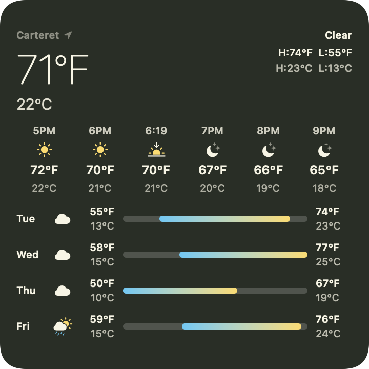
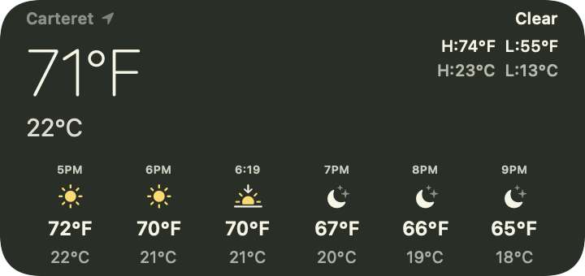
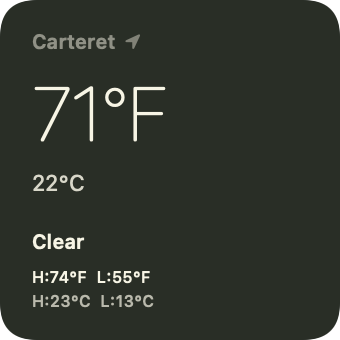

# Weather C+F

Weather C+F is a macOS weather card for people who think in one temperature scale and keep meeting the other. Fahrenheit and Celsius stay on screen together: the reading now, the next few hours, and the days ahead. Each hour and each day lists both units, so the relationship is visible instead of something you convert in your head.

It follows your location, and you can search for another city. Leave the card pinned on the desktop, or add the same layout as a system widget.

**Download (recommended)** → [GitHub Releases (latest)](https://github.com/yxwvwxy/weather-c-f/releases/latest)

Requires macOS 14 or later. On first open, right-click the app and choose Open.

